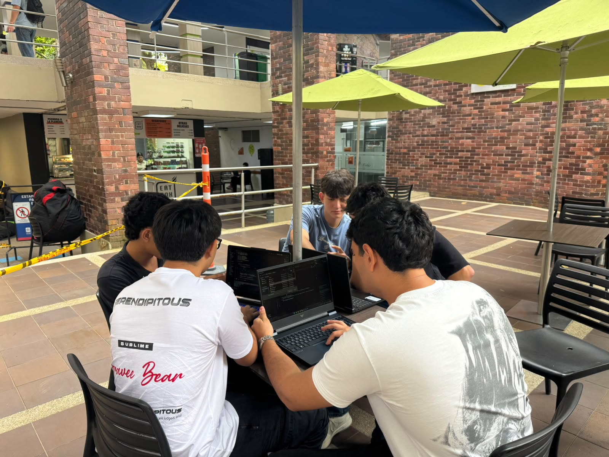

# CollisionJP – Laboratorio de colisiones

**CollisionJP** es un simulador educativo desarrollado como proyecto final de la asignatura Programación de Computadores. Su propósito es facilitar el estudio de las colisiones entre cuerpos mediante la aplicación de principios de la mecánica clásica.

El proyecto permite configurar simulaciones de colisiones, procesar los cálculos físicos, consultar un historial de simulaciones y generar informes en PDF con los resultados y sus respectivas gráficas.

## Autores

### Chicos Estudiosos


Proyecto desarrollado como parte de la asignatura **Programación de Computadores**.

- Jefferson Steven Useche Duarte (líder)
- Vismar Andrés Méndez Romero
- Andrés Felipe Nichoy Calderón
- Juan Diego Ortiz Mora
- Paulo Cesar Claro

## Objetivos

- Comprender el comportamiento de las colisiones elásticas y perfectamente inelásticas.
- Analizar la conservación del momento lineal.
- Estudiar los cambios en la energía cinética durante una colisión.
- Relacionar los parámetros iniciales con los resultados físicos obtenidos.

## Tipos de colisión

El simulador contempla dos tipos:

- **Colisión elástica:** se conservan el momento lineal y la energía cinética.
- **Colisión perfectamente inelástica:** los cuerpos quedan unidos después del impacto. Se conserva el momento lineal, pero no necesariamente la energía cinética.

## Tecnologías utilizadas

- **HTML:** estructura de la interfaz web.
- **CSS:** diseño y presentación visual.
- **JavaScript:** interacción con el usuario y comunicación con el servidor.
- **Java:** servidor HTTP, recepción y validación de datos, gestión del historial y comunicación con Python.
- **Python:** procesamiento de cálculos físicos, generación de gráficas e informes PDF.
- **JSON:** intercambio y almacenamiento de información.

### Librerías

**Java**
- Gson: conversión y procesamiento de datos JSON.

**Python**
- Matplotlib: generación de gráficas.
- NumPy: operaciones numéricas.
- ReportLab: generación de informes PDF.

## Estructura del proyecto

```text
CollisionArena/
│
├── java/
│   ├── lib/
│   │   └── gson-2.15.0.jar
│   ├── Main.java
│   ├── Colision.java
│   ├── JsonManager.java
│   ├── HistorialManager.java
│   └── Servidor.java
│
├── python/
│   ├── procesamiento.py
│   ├── grafica.py
│   └── informe.py
│
├── web/
│   └── index.html
│
├── datos/
│
├── imagenes/
|   └── estudiosos.jpeg
│
├── .gitignore
└── README.md
```

## Funcionamiento

El proyecto integra Java, Python y tecnologías web mediante el siguiente proceso:

1. El usuario introduce los parámetros de la colisión desde la página web.
2. Java recibe y valida los datos enviados por la interfaz.
3. Los parámetros se convierten a formato JSON.
4. Java ejecuta el procesamiento físico mediante Python.
5. Python calcula las velocidades finales, el momento lineal y la energía cinética antes y después de la colisión.
6. Java recibe los resultados y los almacena en el historial.
7. Python genera una gráfica y un informe PDF correspondiente a la última simulación.
8. El usuario puede descargar el informe desde la pestaña **Gráfica**.

## Requisitos

Para ejecutar el proyecto se necesita:

- Java JDK con soporte para el módulo `jdk.httpserver`.
- Python 3.
- Pip para instalar las dependencias de Python.
- Las librerías Gson (incluida en `java/lib`) y las de Python listadas en `requirements.txt` (Matplotlib, NumPy y ReportLab).

## Instalación y ejecución

**1. Clonar el repositorio**

```bash
git clone URL_DEL_REPOSITORIO
```

**2. Instalar las dependencias de Python**

```bash
py -m pip install -r requirements.txt
```

**3. Compilar el proyecto Java**

Desde la carpeta `java`, ejecutar:

```powershell
javac --add-modules jdk.httpserver -cp ".;lib/gson-2.15.0.jar" Main.java Colision.java JsonManager.java HistorialManager.java Servidor.java
```

**4. Iniciar el servidor**

Desde la misma carpeta:

```powershell
java --add-modules jdk.httpserver -cp ".;lib/gson-2.15.0.jar" Main
```

**5. Abrir la aplicación**

Ingresar desde el navegador a:

```text
http://localhost:8080
```

Para detener el servidor, utilizar `Ctrl + C` en la terminal.

## Informes PDF

Cada informe generado contiene:

- Fecha de la simulación.
- Parámetros iniciales.
- Velocidades finales.
- Momento lineal inicial y final.
- Energía cinética inicial y final.
- Análisis de conservación.
- Gráfica comparativa.

El informe corresponde exclusivamente a la última simulación registrada.
